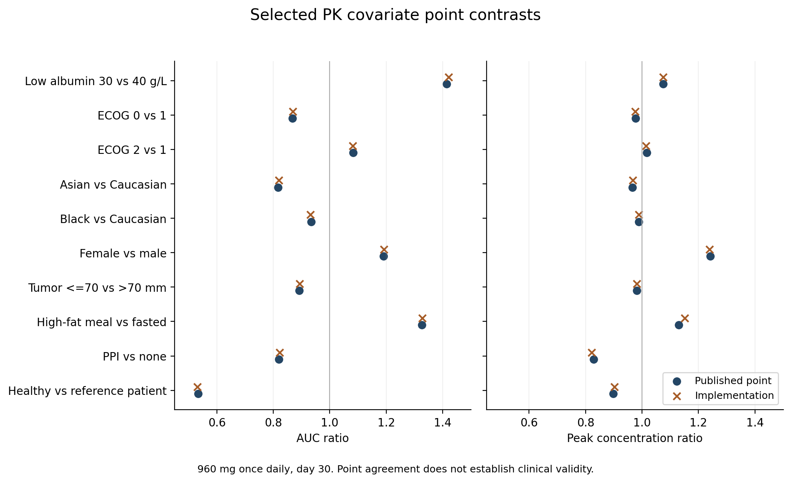
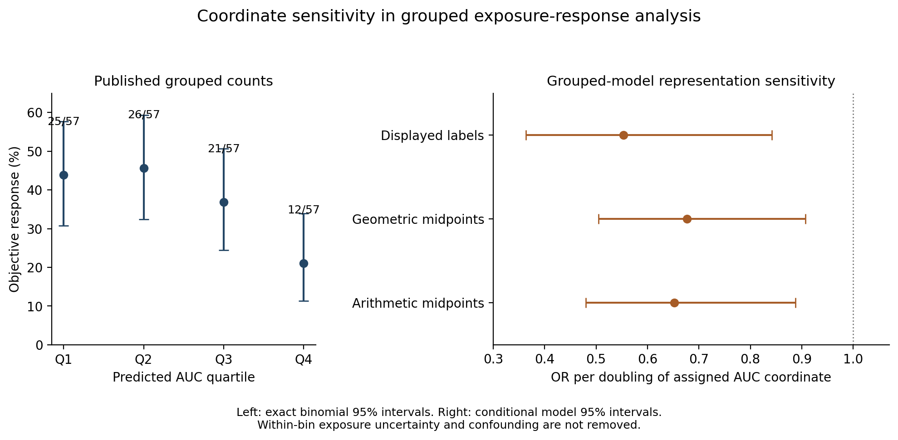

# Sotorasib dose evidence
### Reproducing published pharmacokinetic results and examining the 240 mg versus 960 mg comparison

## Project overview

I used the sotorasib 240 mg versus 960 mg comparison to examine what published exposure data can tell us about dose selection. The sources were public FDA reviews, clinical literature, and a published population pharmacokinetic (popPK) model.

I checked selected published model results at **960 mg once daily**, examined how the grouped exposure-response estimates change under different assumptions, and calculated sample size for a hypothetical response-rate comparison. The PK and grouped exposure-response analyses use published summaries; the design scenarios use stated hypothetical response rates. Individual patient records were not available.

The [randomized-trial summary](docs/TRIAL_EVIDENCE.md) connects the calculations to the reported efficacy, safety, and dose-modification results. A [worked PK example](docs/PK_EXAMPLE.md) follows the albumin coefficient through to exposure, and the [design comparison](docs/DESIGN_SENSITIVITY.md) examines sample size and planning precision across stated assumptions.

The [clinical pharmacology case](docs/CLINICAL_PHARMACOLOGY.md) compares the modeled proton pump inhibitor (PPI) effect with the prescribing information and outlines the patient-level data needed to study exposure and subsequent tolerability. The follow-up analysis is proposed, not completed.

FDA considered the dose-related postmarketing requirement fulfilled in December 2023 and retained 960 mg using the randomized comparison and other supporting evidence. This project examines selected calculations within that evidence; it does not determine a preferred starting dose. [Regulatory perspective](https://doi.org/10.1200/JCO.24.00310).

## Analyses and main findings

| Analysis | Finding | Interpretation |
|---|---|---|
| **Published PK covariate comparisons** | Ten selected comparisons, comprising 20 AUC and Cmax ratios at 960 mg once daily, were reproduced within **1.90%** of the published point values. | These results check selected parts of the implementation. They do not validate the model for clinical decisions. |
| **Grouped exposure-response analysis** | The odds ratio per doubling of the assigned exposure was **0.553** using the displayed group coordinates, **0.677** using geometric midpoints, and **0.653** using arithmetic midpoints. | The estimate changes with the choice of representative exposure. Four aggregate groups cannot account for patient-level differences or establish causation. |
| **Hypothetical response-rate designs** | For assumed rates of 35% versus 25%, **329 per arm at 80% power** and **440 per arm at 90% power**. The extension compares 24 scenarios, all with equal allocation and two-sided alpha 0.05 under a normal approximation. | These are prospective planning assumptions. They do not reconstruct the sponsor's plan or set a minimum sample size for dose optimization. |
| **Randomized-trial evidence** | The reported stratified ORR difference, **960 mg minus 240 mg**, was **6.9 percentage points (90% CI −3.4 to 17.1)**. Grade 3 or higher TEAEs occurred in **64/104 at 960 mg** and **51/104 at 240 mg**. | Efficacy and safety used different cutoffs. Dose reductions were allowed only in the 960-mg arm. These published summaries do not establish equivalence. [Full context](docs/TRIAL_EVIDENCE.md). |

The conditional 95% confidence intervals were **0.364–0.842** for the displayed coordinates, **0.505–0.907** for geometric midpoints, and **0.480–0.887** for arithmetic midpoints. They do not include uncertainty about the representative exposures or confounding.

## Figures



**Figure 1.** Published and reproduced covariate effects on exposure at 960 mg once daily. Only the published point values are compared; their uncertainty bands are not reproduced.



**Figure 2.** Left: response counts in the four predicted-AUC groups from FDA Figure 26, with exact binomial 95% intervals calculated from those counts. Right: exposure-response estimates using three choices of representative exposure, with conditional Wald 95% intervals. These are unadjusted associations.


**Figure 3.** Left: required sample size under hypothetical response-rate differences and power targets. Right: approximate interval half-widths using assumed rates of 35% and 25%. These are planning calculations, not observed trial intervals. [Assumptions and interpretation](docs/DESIGN_SENSITIVITY.md).

## What the analyses show

The model checks test the implementation against published results. The grouped analysis shows how the exposure assigned to each group affects the estimate. These calculations cannot recover patient-level information or settle the clinical dose decision.

Dose selection brings together activity, safety, tolerability, and exposure. A descriptive randomized comparison can inform that decision without being designed for a formal superiority test. The sample-size calculation here addresses a separate, explicitly stated testing scenario. [FDA dosage guidance, Section III.B](https://www.fda.gov/media/164555/download).

## Files and reproduction

```text
data/       Published parameters, extracted results, and source notes
src/        Python analyses and figures; R model and statistical checks
results/    Saved analysis tables and summaries
figures/    PK comparisons, grouped response, and design sensitivity
tests/      Numerical and statistical checks
docs/       Methods, trial evidence, worked examples, and contributions
reports/    Numerical checks; local logs are generated when run
```

The Python analysis was tested with Python 3.13.5 and the package versions in `requirements-tested.txt`. From the repository root, install those versions in an isolated environment and run:

```bash
python -m pip install -r requirements-tested.txt
python src/run_all.py
```

The runner executes the tests, model checks, exposure-response analysis, design scenarios, and figure generation. The calculations are deterministic. The saved [numerical checks](reports/numerical_checks.json) report grid-refinement and integration results. Each run also creates local command logs and an execution record with package versions and input/output hashes in `reports/`; these generated records are not tracked in Git.

### R checks

After running the Python pipeline, run the R checks below. They use the same published inputs or hypothetical assumptions as Python. The PK simulation requires `rxode2` and `jsonlite`; tested package versions are in [requirements-R.txt](requirements-R.txt). The input tests and both statistical checks use only base R. The scripts were tested with R 4.6.1.

```bash
Rscript tests/test_pk_inputs.R
Rscript src/check_pk.R
Rscript src/check_statistics.R
Rscript src/check_design_sensitivity.R
```

- [test_pk_inputs.R](tests/test_pk_inputs.R) checks accepted covariates and rejects invalid or nonphysical inputs before simulation.
- [check_pk.R](src/check_pk.R) uses `rxode2` for the ten covariate comparisons at 960 mg once daily. It checks a finer time grid and compares AUC and Cmax ratios with Python. A separate fixed-parameter simulation checks AUC against dose × relative bioavailability / apparent clearance.
- [check_statistics.R](src/check_statistics.R) compares the three grouped binomial fits with Python, calculates exact response intervals, and uses `power.prop.test` for the original hypothetical sample-size example.
- [check_design_sensitivity.R](src/check_design_sensitivity.R) independently recalculates all 24 planning scenarios and five precision examples and checks agreement with Python.

The R tables are saved as `results/r_*.csv`.

Agreement between implementations checks the calculations under shared assumptions. It does not provide independent clinical evidence or resolve the source limitations below.

[Automated reproduction](.github/workflows/reproduce.yml) runs the Python pipeline, the R input tests, and both base R statistical checks from empty output directories. The `rxode2` PK simulation is run separately using the documented R environment.

## Limitations

- The model uses published parameters and aggregate results. It was not fitted to individual trial data, and agreement with selected published values is not clinical validation.
- The exposure-response analysis cannot adjust for patient characteristics. FDA Figure 26 totals 228 patients, while nearby methods describe 248; that difference remains unresolved.
- Representative exposures and model-parameter interpretations require assumptions. Details are in the [methods](docs/ANALYSIS_NOTES.md) and [parameter notes](data/PARAMETER_RESOLUTION.md).
- Earlier exposure-overlap projections, toxicity/utility calculations, and an incomplete R parameter-estimation example are excluded from the findings above. The [methods](docs/ANALYSIS_NOTES.md#analyses-not-used-in-the-conclusions) explain their limitations.

## Primary sources

1. [FDA. LUMAKRAS NDA 214665 multidisciplinary review (2021)](https://www.accessdata.fda.gov/drugsatfda_docs/nda/2021/214665Orig1s000MultidisciplineR.pdf).
2. [Nagase et al. AAPS Journal. 2025;27:26](https://doi.org/10.1208/s12248-024-01013-6).
3. [Hochmair et al. European Journal of Cancer. 2024;208:114204](https://doi.org/10.1016/j.ejca.2024.114204).
4. [Singh, Vellanki, and Pazdur. Journal of Clinical Oncology. 2025;43:248–250](https://doi.org/10.1200/JCO.24.00310).
5. [FDA. Optimizing the Dosage of Human Prescription Drugs and Biological Products for the Treatment of Oncologic Diseases (August 2024)](https://www.fda.gov/media/164555/download).
6. [Amgen. LUMAKRAS U.S. Prescribing Information (January 2025)](https://www.pi.amgen.com/united_states/lumakras/lumakras_pi_hcp_english.pdf), Sections 2.4, 7.1, and 12.2–12.3; checked October 11, 2026 for the clinical pharmacology case.

Source locations and access limitations are recorded in the [source notes](data/SOURCE_NOTES.md). Evidence cutoff: September 26, 2026; full randomized article reviewed September 27, 2026. Analysis and documentation updated October 11, 2026.

Project led by Sohum Mallik. [Contributions](docs/CONTRIBUTIONS.md).
