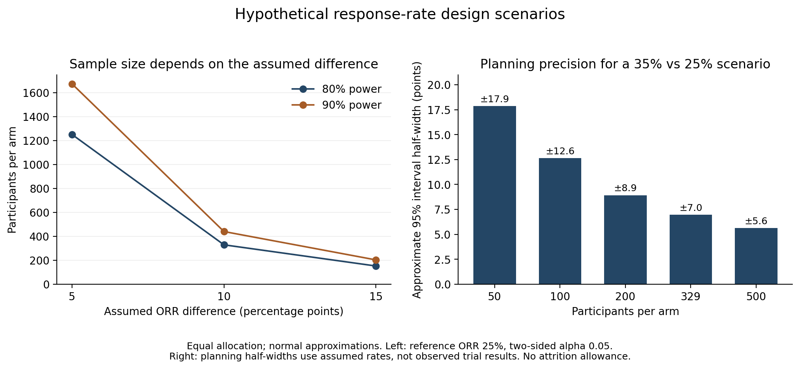

# Response-rate design scenarios

The original example assumed response rates of 35% and 25% and gave 329 participants per arm for 80% power. That number depends on the assumed response rates, the difference to be detected, and the testing objective. This extension varies those assumptions to show how they affect feasibility and precision.

These are hypothetical planning scenarios. The response rates were not estimated from the randomized sotorasib comparison, and the calculations do not assess that study's power after observing its results.

## Sample size

The [24 scenarios](../data/design_scenarios.csv) combine reference response rates of 20%, 25%, 30%, and 35%; absolute improvements of 5, 10, and 15 percentage points; and target power of 80% or 90%. Each uses equal allocation and a two-sided alpha of 0.05. The normal approximation uses a pooled-null rejection boundary and separate binomial variances under the alternative, including both rejection tails. There is no continuity correction or attrition allowance.

For a reference response rate of 25%:

| Assumed comparison response | Absolute difference | Per arm at 80% power | Per arm at 90% power |
|---|---:|---:|---:|
| 30% | 5 points | 1,251 | 1,674 |
| 35% | 10 points | 329 | 440 |
| 40% | 15 points | 152 | 203 |

Smaller assumed differences require much larger samples in these scenarios. A clinically meaningful difference needs justification before selecting a sample size; choosing a larger difference simply to make enrollment feasible would change the question being tested. The [complete results](../results/design_sensitivity.csv) retain the baseline rates, target power, and achieved power at the selected integer sample size and one fewer participant per arm.

## Planning precision

For assumed response rates of 35% and 25%, a separate calculation approximates the half-width of a 95% interval for their difference:

```text
1.96 × sqrt([0.35 × 0.65 + 0.25 × 0.75] / n_per_arm)
```

The code uses the full standard-normal quantile rather than rounded 1.96. This gives a planning half-width of about **12.6 percentage points at 100 per arm**, compared with **7.0 points at 329 per arm**. These are model-based approximations using assumed probabilities. They are not confidence intervals from observed data and do not guarantee the width or coverage of a future trial's interval. The [precision table](../results/design_precision.csv) includes five sample sizes.



## What this leaves to the study team

A formal superiority calculation addresses one possible objective. A dose-comparison study may instead emphasize estimation of activity, safety, tolerability, and exposure. FDA's [August 2024 dosage guidance, Section III.B](https://www.fda.gov/media/164555/download), explains why such a comparison need not meet the power requirements of a registrational superiority or noninferiority trial.

Response-assessment timing, handling of missing assessments, dose modifications, follow-up, and enrollment feasibility still need specification. An enrollment allowance alone would not resolve biased missing outcomes. These calculations provide neither a noninferiority margin nor an optimal dose recommendation.

## Reproduction

[Python](../src/design_sensitivity.py) solves for sample size and generates both tables and the figure. The [base R check](../src/check_design_sensitivity.R) independently uses `power.prop.test(strict = TRUE)` for all 24 scenarios and verifies the five precision approximations. It compares the integer sample sizes and powers with Python and stops if they disagree. Both implementations use the same assumptions.
